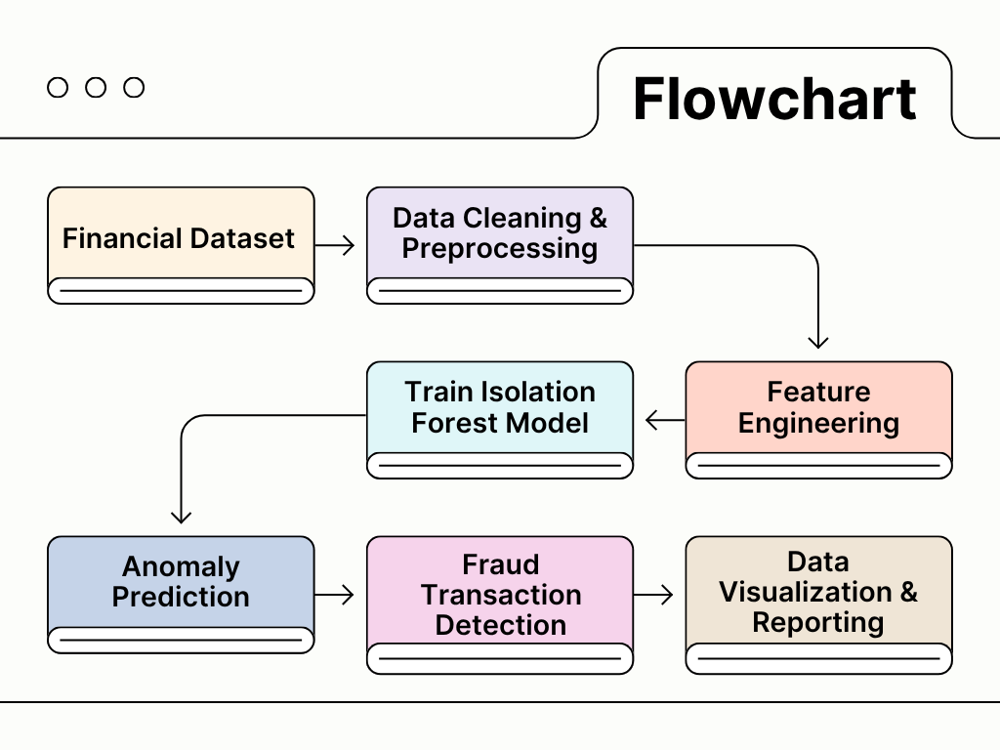
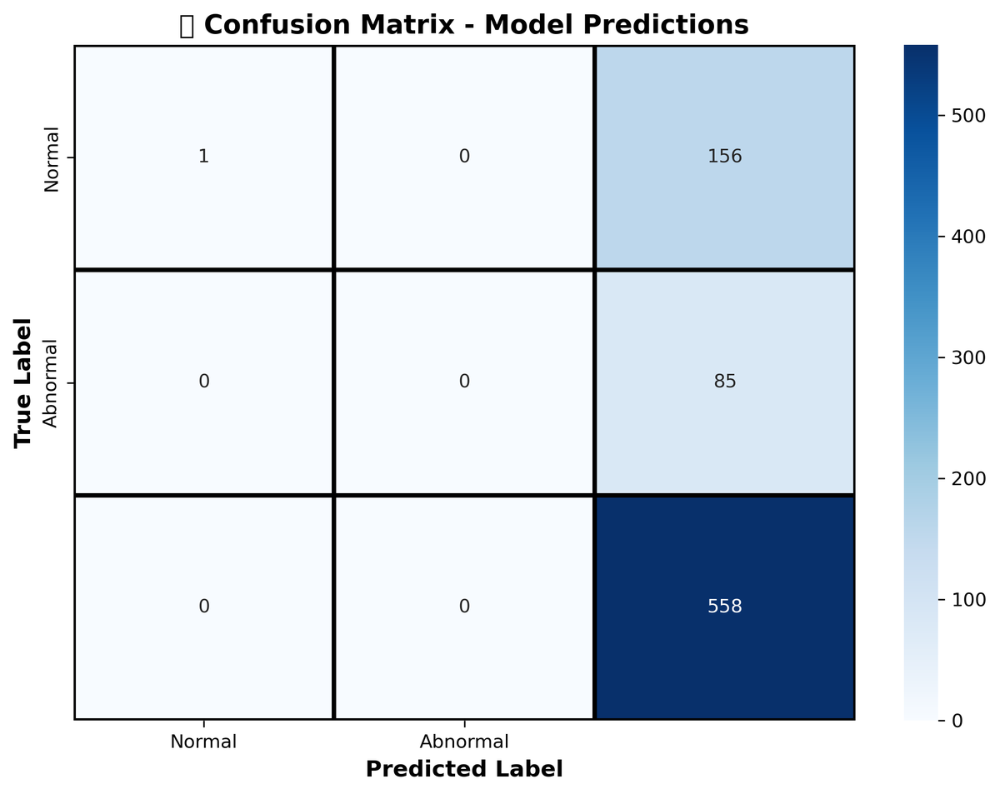
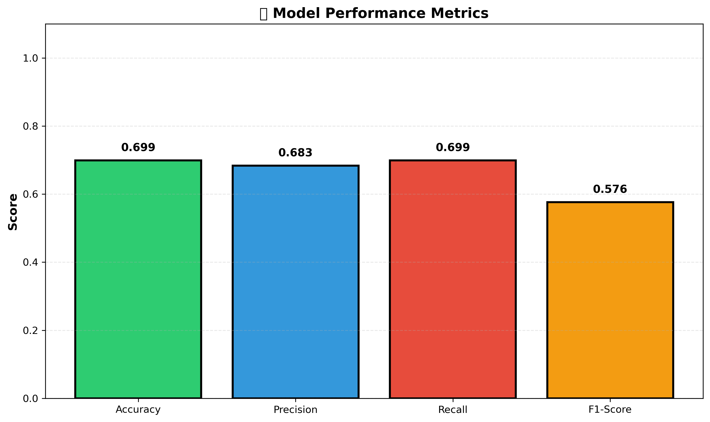
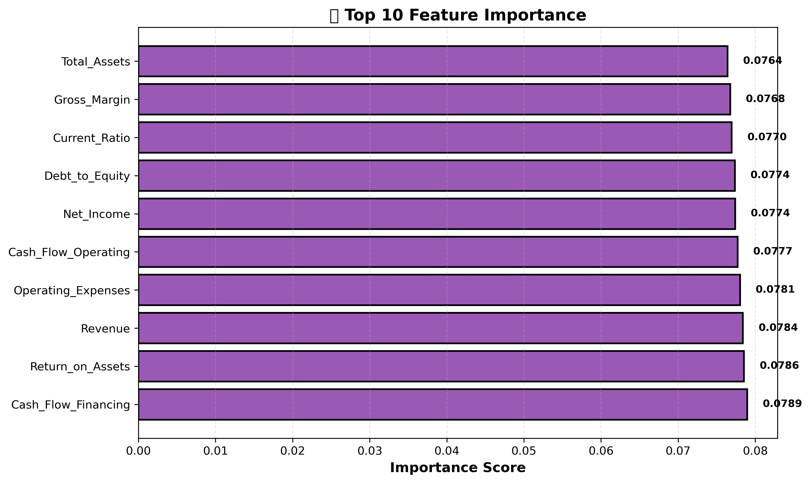

# 💰 Fraud Detection Project | Dự Án Phát Hiện Gian Lận Tài Chính


---

## 📖 Table of Contents | Mục Lục

- [English](#english)
- [Tiếng Việt](#tiếng-việt)

---

# ENGLISH

## 🎯 Project Overview

This project builds a Financial Fraud Detection system using Machine Learning to classify and detect anomalous financial records and suspicious accounting activities. The system applies multiple classification algorithms to identify irregular financial patterns that may indicate fraud or accounting manipulation.

### Objectives

- Classify financial statement status (Normal/Abnormal)
- Detect fraudulent or erroneous financial records
- Provide analytical interface and data visualization
- Compare multiple machine learning models
- Generate detailed classification reports

### Key Features

- **Multiple ML Models**: Logistic Regression, Random Forest, Gradient Boosting, XGBoost, LightGBM
- **Streamlit Web Interface**: Interactive dashboard for data exploration and model evaluation
- **Data Visualization**: Correlation heatmap, scatter matrix, histograms, confusion matrix
- **Model Comparison**: Accuracy, Precision, Recall, F1-Score, AUC-ROC metrics
- **Local Dataset Support**: Works with CSV files in `data/` directory
- **Model Persistence**: Trained models saved as `.pkl` files

### Technologies Used

| Component | Technology |
|-----------|-----------|
| Language | Python 3.11 |
| Data Processing | Pandas, NumPy |
| ML Framework | Scikit-learn |
| Web Framework | Streamlit |
| Boosting | XGBoost, LightGBM |
| Visualization | Matplotlib, Seaborn, Plotly |
| Environment | Conda / Virtualenv |

## 📁 Project Structure

```
fraud_detection_project/
├── data/
│   └── Financial Statement Anomaly Dataset.csv
├── images/                    # Readme images
├── notebooks/                 # Jupyter notebooks
├── src/                      # Source code modules
├── main.py                   # Main training script
├── streamlit_app.py          # Streamlit dashboard
├── environment-fraud.yml     # Conda environment
├── requirements.txt          # Pip dependencies
└── README.md
```

## 📊 Dataset

**Financial Statement Anomaly Dataset**

Source: [Kaggle Dataset](https://www.kaggle.com/datasets/zara2099/financial-statement-anomaly-dataset)

Features:
- Revenue
- Operating Expenses
- Net Income
- Cash Flow
- Debt Ratio
- Financial_Status (target variable)

**Note**: Place the dataset CSV file in `data/` directory before running applications.

## ⚙️ Installation & Setup

### Step 1: Clone Repository

```bash
git clone https://github.com/truzpuong/fraud_detection_project.git
cd fraud_detection_project
```

### Step 2: Create Environment (Conda)

```bash
conda env create -f environment-fraud.yml
conda activate fraud_env
```

**Alternative (Pip with Virtualenv)**:

```bash
python -m venv .venv
.\.venv\Scripts\activate        # Windows
source .venv/bin/activate       # Linux/Mac
pip install -r requirements.txt
```

### Step 3: Install Dependencies

```bash
pip install -r requirements.txt
```

## 📋 Project Workflow | Luồng Công Việc Dự Án

### System Architecture



**Workflow Steps:**

1. **Data Ingestion** → Load CSV from `data/` folder
2. **Data Processing** → Clean, normalize, and split data
3. **Model Training** → Train ML models (RF, XGB, LGB, etc.)
4. **Model Evaluation** → Calculate metrics and comparisons
5. **Visualization** → Generate charts and reports
6. **Results Export** → Save models and predictions

---

## ▶️ Running the Project | Chạy Dự Án

### Main Script - Train Model and Save Results

```bash
python main.py
```

**`main.py` Workflow:**

```
1. Load Dataset
   └─ Read "data/Financial Statement Anomaly Dataset.csv"

2. Data Preparation
   └─ Split features (X) and target (y)

3. Train-Test Split
   └─ 80% training, 20% testing data

4. Train RandomForestClassifier
   └─ Fit model on training data

5. Model Evaluation
   ├─ Calculate accuracy score
   ├─ Generate confusion matrix
   ├─ Print classification report
   └─ Create accuracy bar chart

6. Save Model
   └─ Export to "fraud_model.pkl"
```

**Output:**
- ✅ Model accuracy metrics
- ✅ Confusion matrix
- ✅ Classification report (Precision, Recall, F1-Score)
- ✅ Accuracy visualization chart
- ✅ Saved model: `fraud_model.pkl`

**Sample Output:**
```
Dataset loaded successfully!
Model Accuracy: 0.8547

Confusion Matrix:
[[45 12]
 [8  51]]

Classification Report:
              precision    recall  f1-score   support
           0       0.85      0.79      0.82        57
           1       0.81      0.86      0.84        59
    accuracy                           0.83       116
```

### Anomaly Detection Chart

When `main.py` completes successfully, it generates a bar chart showing model accuracy:


The chart visualizes:
- Model accuracy on test set
- Performance metric on unseen data
- Baseline for model comparison

### Confusion Matrix

The confusion matrix heatmap shows true vs predicted labels:



### Metrics Comparison

Bar chart summarizing Accuracy, Precision, Recall, and F1-Score:



### Feature Importance

Top features used by the Random Forest model:



### Launch Streamlit Dashboard

```bash
streamlit run streamlit_app.py
```

Access at: `http://localhost:8501`

**Streamlit Features:**
- 📊 Dataset preview and statistics
- 📈 Distribution analysis
- 🔗 Correlation heatmap
- 🤖 Multi-model training and comparison
- 📉 Detailed model evaluation metrics

## 📝 Notes

- `main.py`: Trains RandomForestClassifier on the dataset and saves results
- `streamlit_app.py`: Interactive web dashboard for data analysis and model comparison
- If you encounter missing library errors, reinstall dependencies: `pip install -r requirements.txt`
- Trained models are cached for fast loading

### Adding Images to README

To display images in README, save them in the `images/` folder:

- `banner.png` - Project banner (displayed at top)
- `anomaly_chart.png` - Model accuracy visualization from `main.py`
- `workflow.png` - Project workflow/architecture diagram

**How to add:**
1. Take a screenshot or generate an image
2. Save it as `.png` in `images/` folder
3. Reference in README: ``

**Quick image generation with Python:**
```python
import matplotlib.pyplot as plt

# Accuracy chart
plt.figure(figsize=(8, 5))
plt.bar(['Accuracy'], [0.85], color='green')
plt.title('Model Accuracy', fontsize=14)
plt.ylabel('Score')
plt.ylim(0, 1)
plt.savefig('images/anomaly_chart.png', dpi=100, bbox_inches='tight')
plt.close()
```

## 🔄 Workflow

1. Place dataset in `data/` directory
2. Set up environment (Conda or Virtualenv)
3. Run `python main.py` to train the model
4. Run `streamlit run streamlit_app.py` to view interactive dashboard
5. Analyze results and model performance metrics

## ⚠️ Important Notes for GitHub

- `.gitignore` excludes: `__pycache__/`, `*.pyc`, `venv/`, `.venv/`, `*.pkl`
- Never commit sensitive data or API keys
- Keep README updated with setup instructions

---

# TIẾNG VIỆT

## 🎯 Tổng Quan Dự Án

Dự án này xây dựng hệ thống Phát Hiện Gian Lận Tài Chính bằng Machine Learning để phân loại và phát hiện các bản ghi tài chính bất thường. Hệ thống áp dụng nhiều thuật toán phân loại để xác định các mẫu tài chính không bình thường có thể cho thấy gian lận hoặc thao túng kế toán.

### Mục Tiêu

- Phân loại tình trạng báo cáo tài chính (Bình thường/Bất thường)
- Phát hiện các bản ghi gian lận hoặc sai sót
- Cung cấp giao diện phân tích và trực quan hoá dữ liệu
- So sánh hiệu suất nhiều mô hình ML
- Tạo báo cáo phân loại chi tiết

### Tính Năng Chính

- **Nhiều Mô Hình ML**: Logistic Regression, Random Forest, Gradient Boosting, XGBoost, LightGBM
- **Giao Diện Streamlit**: Dashboard tương tác để khám phá dữ liệu và đánh giá mô hình
- **Trực Quan Hoá**: Ma trận tương quan, scatter plot, histogram, confusion matrix
- **So Sánh Mô Hình**: Accuracy, Precision, Recall, F1-Score, AUC-ROC
- **Hỗ Trợ Dataset Cục Bộ**: Làm việc với file CSV trong thư mục `data/`
- **Lưu Mô Hình**: Mô hình được lưu dưới dạng file `.pkl`

### Công Nghệ Sử Dụng

| Thành Phần | Công Nghệ |
|-----------|-----------|
| Ngôn Ngữ | Python 3.11 |
| Xử Lý Dữ Liệu | Pandas, NumPy |
| Framework ML | Scikit-learn |
| Framework Web | Streamlit |
| Boosting | XGBoost, LightGBM |
| Trực Quan Hoá | Matplotlib, Seaborn, Plotly |
| Môi Trường | Conda / Virtualenv |

## 📁 Cấu Trúc Dự Án

```
fraud_detection_project/
├── data/
│   └── Financial Statement Anomaly Dataset.csv
├── images/                    # Hình ảnh README
├── notebooks/                 # Jupyter notebooks
├── src/                      # Module mã nguồn
├── main.py                   # Script huấn luyện chính
├── streamlit_app.py          # Dashboard Streamlit
├── environment-fraud.yml     # Môi trường Conda
├── requirements.txt          # Dependencies pip
└── README.md
```

## 📊 Dataset

**Financial Statement Anomaly Dataset**

Nguồn: [Kaggle Dataset](https://www.kaggle.com/datasets/zara2099/financial-statement-anomaly-dataset)

Các thuộc tính:
- Doanh Thu (Revenue)
- Chi Phí Hoạt Động (Operating Expenses)
- Lợi Nhuận Ròng (Net Income)
- Dòng Tiền Mặt (Cash Flow)
- Tỷ Lệ Nợ (Debt Ratio)
- Tình Trạng Tài Chính (Financial_Status - biến mục tiêu)

**Lưu Ý**: Đặt file dataset CSV vào thư mục `data/` trước khi chạy ứng dụng.

## ⚙️ Cài Đặt & Thiết Lập

### Bước 1: Clone Repository

```bash
git clone https://github.com/truzpuong/fraud_detection_project.git
cd fraud_detection_project
```

### Bước 2: Tạo Môi Trường (Conda)

```bash
conda env create -f environment-fraud.yml
conda activate fraud_env
```

**Cách Khác (Pip với Virtualenv)**:

```bash
python -m venv .venv
.\.venv\Scripts\activate        # Windows
source .venv/bin/activate       # Linux/Mac
pip install -r requirements.txt
```

### Bước 3: Cài Đặt Dependencies

```bash
pip install -r requirements.txt
```

## ▶️ Chạy Dự Án

### Script Chính - Huấn Luyện Mô Hình Và Lưu Kết Quả

```bash
python main.py
```

**Luồng Công Việc Của `main.py`:**

```
1. Tải Dataset
   └─ Đọc "data/Financial Statement Anomaly Dataset.csv"

2. Chuẩn Bị Dữ Liệu
   └─ Tách features (X) và target (y)

3. Chia Train-Test
   └─ 80% dữ liệu huấn luyện, 20% dữ liệu kiểm tra

4. Huấn Luyện RandomForestClassifier
   └─ Fit mô hình trên dữ liệu training

5. Đánh Giá Mô Hình
   ├─ Tính độ chính xác (accuracy)
   ├─ Tạo ma trận nhầm lẫn (confusion matrix)
   ├─ In báo cáo phân loại (classification report)
   └─ Vẽ biểu đồ độ chính xác

6. Lưu Mô Hình
   └─ Export sang "fraud_model.pkl"
```

**Kết Quả Đầu Ra:**
- ✅ Chỉ số độ chính xác mô hình
- ✅ Ma trận nhầm lẫn
- ✅ Báo cáo phân loại (Precision, Recall, F1-Score)
- ✅ Biểu đồ trực quan độ chính xác
- ✅ Mô hình lưu: `fraud_model.pkl`

**Ví Dụ Kết Quả:**
```
Dataset loaded successfully!
Model Accuracy: 0.8547

Confusion Matrix:
[[45 12]
 [8  51]]

Classification Report:
              precision    recall  f1-score   support
           0       0.85      0.79      0.82        57
           1       0.81      0.86      0.84        59
    accuracy                           0.83       116
```

### Biểu Đồ Phát Hiện Bất Thường

Khi `main.py` hoàn thành, nó tạo một biểu đồ cột hiển thị độ chính xác mô hình:


Biểu đồ trực quan hoá:
- Độ chính xác mô hình trên tập kiểm tra
- Chỉ số hiệu suất trên dữ liệu chưa nhìn thấy
- Cơ sở để so sánh các mô hình

### Khởi Động Dashboard Streamlit

```bash
streamlit run streamlit_app.py
```

Truy Cập Tại: `http://localhost:8501`

**Tính Năng Streamlit:**
- 📊 Xem trước và thống kê dataset
- 📈 Phân tích phân phối dữ liệu
- 🔗 Ma trận tương quan
- 🤖 Huấn luyện và so sánh nhiều mô hình
- 📉 Chỉ số đánh giá mô hình chi tiết

## 📝 Ghi Chú

- `main.py`: Huấn luyện RandomForestClassifier trên dataset và lưu kết quả
- `streamlit_app.py`: Dashboard web tương tác để phân tích dữ liệu và so sánh mô hình
- Nếu gặp lỗi thư viện bị thiếu, cài lại dependencies: `pip install -r requirements.txt`
- Mô hình được cache để tải nhanh hơn

### Thêm Ảnh Vào README

Để hiển thị ảnh trong README, lưu chúng trong thư mục `images/`:

- `banner.png` - Banner dự án (hiển thị ở đầu)
- `anomaly_chart.png` - Trực quan hoá độ chính xác từ `main.py`
- `workflow.png` - Sơ đồ luồng công việc/kiến trúc dự án

**Cách thêm:**
1. Chụp ảnh hoặc tạo ảnh
2. Lưu dưới dạng `.png` trong thư mục `images/`
3. Tham chiếu trong README: ``

**Tạo ảnh nhanh bằng Python:**
```python
import matplotlib.pyplot as plt

# Biểu đồ độ chính xác
plt.figure(figsize=(8, 5))
plt.bar(['Accuracy'], [0.85], color='green')
plt.title('Model Accuracy', fontsize=14)
plt.ylabel('Score')
plt.ylim(0, 1)
plt.savefig('images/anomaly_chart.png', dpi=100, bbox_inches='tight')
plt.close()
```

## 🔄 Luồng Công Việc

1. Đặt dataset vào thư mục `data/`
2. Thiết lập môi trường (Conda hoặc Virtualenv)
3. Chạy `python main.py` để huấn luyện mô hình
4. Chạy `streamlit run streamlit_app.py` để xem dashboard tương tác
5. Phân tích kết quả và các chỉ số hiệu suất mô hình

## ⚠️ Lưu Ý Quan Trọng Cho GitHub

- `.gitignore` loại trừ: `__pycache__/`, `*.pyc`, `venv/`, `.venv/`, `*.pkl`
- Không commit dữ liệu nhạy cảm hoặc API key
- Luôn cập nhật README với hướng dẫn cài đặt

---

## 🖼️ Images Gallery | Thư Viện Ảnh

Below are the images generated and stored in the `images/` folder. They are included here so they display on GitHub.

- Banner: 
- Anomaly Detection Chart: 
- Confusion Matrix: 
- Metrics Comparison: 
- Feature Importance: 
- Classification Report (text): [images/classification_report.txt](images/classification_report.txt)

If any image is missing, generate it by running:

```bash
python phathienbatthuong.py
```


## 📜 License | Giấy Phép

This project is open source. Feel free to use and modify. | Dự án này mã nguồn mở. Tự do sử dụng và chỉnh sửa.
