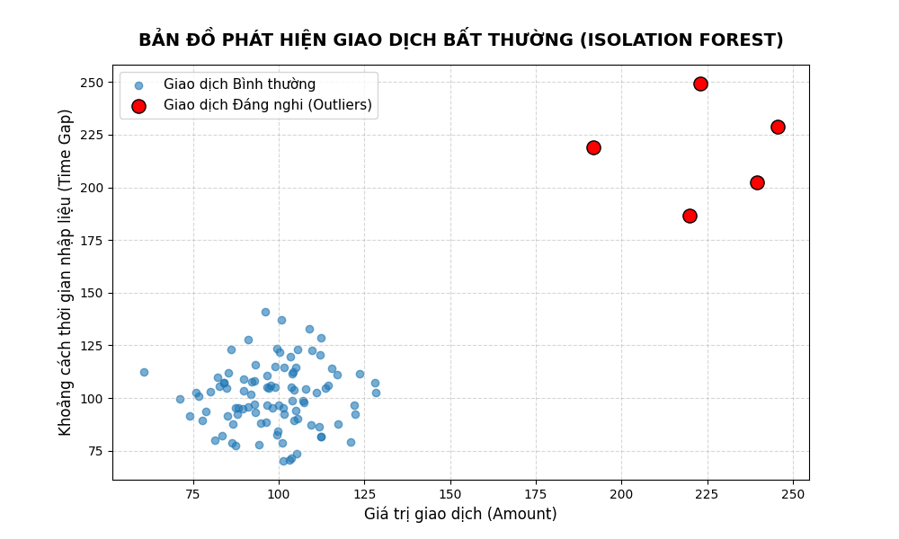

# 💰 Financial Fraud Detection Project


## Overview

This project applies Machine Learning techniques to detect anomalous financial transactions and suspicious accounting activities.

The system uses anomaly detection algorithms to identify irregular financial patterns that may indicate fraud, accounting manipulation, or abnormal transaction behavior.

This project was developed for educational and research purposes in financial analytics and fraud detection.

# 🎯 Objectives

- Detect abnormal financial transactions
- Apply Machine Learning in accounting
- Support fraud analysis and auditing
- Visualize anomaly detection results

---

# ✨ Features

- Financial anomaly detection
- Fraud transaction monitoring
- Machine Learning-based prediction
- Transaction pattern analysis
- Data visualization and reporting
- Isolation Forest anomaly scoring

# 🧠 Công nghệ sử dụng

| Thành phần | Công nghệ |
|---|---|
| Ngôn ngữ | Python 3.11 |
| Machine Learning | Scikit-learn |
| Thuật toán | Isolation Forest |
| Xử lý dữ liệu | Pandas, NumPy |
| Visualization | Matplotlib, Seaborn |
| Môi trường | Anaconda |
| IDE | VSCode |
| Quản lý mã nguồn | Git & GitHub |

---

# 📁 Cấu trúc thư mục

```bash
fraud_detection_project/
│
├── data/                         # Dataset
├── images/                       # Hình ảnh README
│   ├── anomaly_chart.png
│   ├── banner.png
│   └── workflow.png
│
├── notebooks/                    # Notebook
│
├── .env                          # Virtual environment
├── .gitignore
├── basic_math.py                 # Python cơ bản
├── bieudophathienGDBT.py         # Fraud detection visualization
├── moi_truong_ao.py              # Virtual environment setup
└── README.md
```

---

# 📊 Dataset

## Financial Statement Anomaly Dataset

[View Dataset on Kaggle](https://www.kaggle.com/datasets/zara2099/financial-statement-anomaly-dataset)

The dataset includes:
- transaction amount
- account data
- financial categories
- anomaly labels
- timestamps

Used for:
- financial fraud detection
- anomaly analysis
- suspicious transaction monitoring

---

# ⚙️ Installation

## 1️⃣ Clone project

```bash
git clone https://github.com/truzpuong/fraud_detection_project.git
```

---

## 2️⃣ Move into project directory

```bash
cd fraud_detection_project
```

---

## 3️⃣ Create virtual environment

```bash
conda create -n fraud_env python=3.11
```

---

## 4️⃣ Activate environment

```bash
conda activate fraud_env
```

After activation:

```bash
(fraud_env)
```

---

## 5️⃣ Install dependencies

```bash
pip install pandas numpy matplotlib seaborn scikit-learn pyod jupyter
```

Or:

```bash
pip install -r requirements.txt
```

---

# ▶️ Cách chạy dự án

## Chạy file phát hiện gian lận

```bash
python detect_fraud.py
```

---

## Chạy Jupyter Notebook

```bash
jupyter notebook
```

---

# 🤖 Thuật toán sử dụng

## Isolation Forest

Isolation Forest là thuật toán Machine Learning dùng để phát hiện:
- outlier
- anomaly
- fraud transaction

Ý tưởng:
- dữ liệu bất thường sẽ dễ bị “cô lập”
- anomaly có path ngắn hơn dữ liệu bình thường

Ưu điểm:
- chạy nhanh
- hiệu quả với dữ liệu lớn
- không cần label quá nhiều

---

# 📈 Quy trình xử lý dữ liệu

1. Load dataset
2. Làm sạch dữ liệu
3. Encode dữ liệu categorical
4. Huấn luyện mô hình
5. Dự đoán anomaly
6. Visualization kết quả

---

# 🧪 Ví dụ code

## Huấn luyện mô hình

```python
from sklearn.ensemble import IsolationForest

model = IsolationForest(
    contamination=0.02,
    random_state=42
)

model.fit(X)
```

---

# 📊 Kết quả đạt được

Mô hình có thể:
- phát hiện giao dịch bất thường
- phân loại transaction đáng ngờ
- hỗ trợ kiểm toán tài chính

Ví dụ:
- giao dịch giá trị quá lớn
- giao dịch khác pattern thông thường
- transaction bất thường theo thời gian

---

# 🔐 Environment Variables (bảo mật)

Project sử dụng file `.env` để lưu:
- API key
- thông tin nhạy cảm

Ví dụ:

```env
API_KEY=your_api_key
```

File `.env` đã được thêm vào `.gitignore`.

---

# 🛠️ Tech Stack

- Python
- Pandas
- NumPy
- Matplotlib
- Scikit-learn (Machine Learning)
- Anaconda
- VSCode
- GitHub

---

# 🚀 Future Improvements

- Real-time fraud detection
- Streamlit dashboard integration
- Deep Learning anomaly models
- ERP/SAP financial integration
- Cloud deployment
- Explainable AI (XAI)

---

# 🖥️ Output Example

```bash
Loading dataset...

Training model...

Anomaly transactions detected: 42

Accuracy: 96%
```
# 📈 Anomaly Detection Result


# 🔄 Workflow


---
